# Tipps und Techniken für das Mastering von 3D-Beleuchtung in CGI

Erfahren Sie mehr über 3D-Beleuchtung und wie Sie verschiedene Lichtbedingungen erstellen, die eine computergenerierte Szene vollständig verändern können, sowie darüber, wie Objekte darin aussehen.

Wir nehmen die Welt um uns herum mit unseren Sinnen wahr: wir hören, wir fühlen, wir riechen, wir sehen. Wir können sehen, weil unsere Augen Informationen aufnehmen, die uns durch elementare Partikeln, Fotonen genannt, gebracht werden. Diese Information wird von unserem Gehirn verarbeitet, um ein Bild zu erzeugen. Was wir als Objektfarbe, Glanz, translucency oder metallic Eigenschaften interpretieren, sind alle Produkte der Wechselwirkung zwischen den Fotonen und der Objektoberfläche.

Die Lichtmechanik in einer computergenerierten 3D-Szene folgt dem gleichen natürlichen Prinzip der Fotonenstreuung, und zwar durch einen Prozess namens &quot;Raytracing&quot;. Strahlen springen von Formen ab und interagieren mit ihren Materialien, wodurch sie effektiv definieren, wie Objekte im endgültigen Bild erscheinen. Das Licht legt die Dimensionalität aller Elemente einer 3D-Szene.

Manche Materials reagieren empfindlicher auf Lichtverhältnisse als andere. Nehmen wir zum Beispiel Metalle: ein Chromobjekt im Grunde alles um es herum reflektiert. Wenn ein Licht bewegt wird, heller oder größer wird, sind alle diese Informationen direkt auf der Chromoberfläche in nahezu spiegelähnlichen Details sichtbar, sodass sie von einem Lichtzustand zum anderen völlig unterschiedlich erscheinen können.

## 3D-Lichter für effektives 3D-Rendering verwenden

Der Prozess der Erstellung eines 3D-Renderings ist nie ganz derselbe, aber dies sind die häufigsten Schritte:

1. Erstellen oder Erfassen von Objekten
1. Szene
1. Rahmen der Szene
1. **Beleuchtung**
1. Erstellen oder Zuweisen von Materialien
1. Rendern

Wenn du in die Beleuchtungsphase kommst, ist es ideal, deine Beleuchtung einzurichten, bevor du an den Materialien arbeitest. Dazu können Sie der gesamten Szene ein neutralgraues, mattes Material zuweisen. Auf diese Weise kannst du besser sehen und verstehen, wie sich die Lichter auf die Silhouetten des Objekts in der Szene auswirken. Wenn die Materials fertig sind, muss die Beleuchtung möglicherweise weiter verfeinert werden.

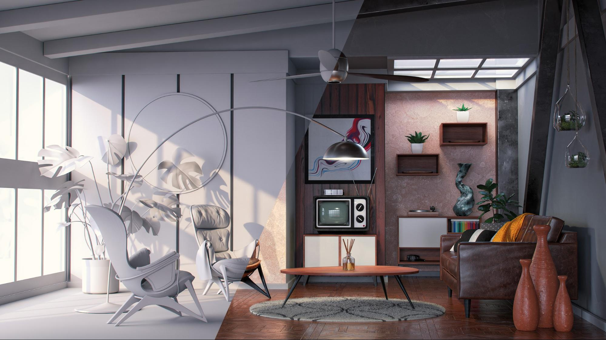

Es ist am besten, nacheinander an den Lichtern zu arbeiten. Die aktive Lichtquelle sollte die einzige sein, die in der Szene zu sehen ist, während alle anderen Lampen vorübergehend ausgeschaltet sein sollten. Auf diese Weise können Sie sehen, wie ein bestimmtes Licht die Szene beeinflusst, und das ändern, indem Sie an den Eigenschaften wie Position, Richtung, Intensität usw. arbeiten.

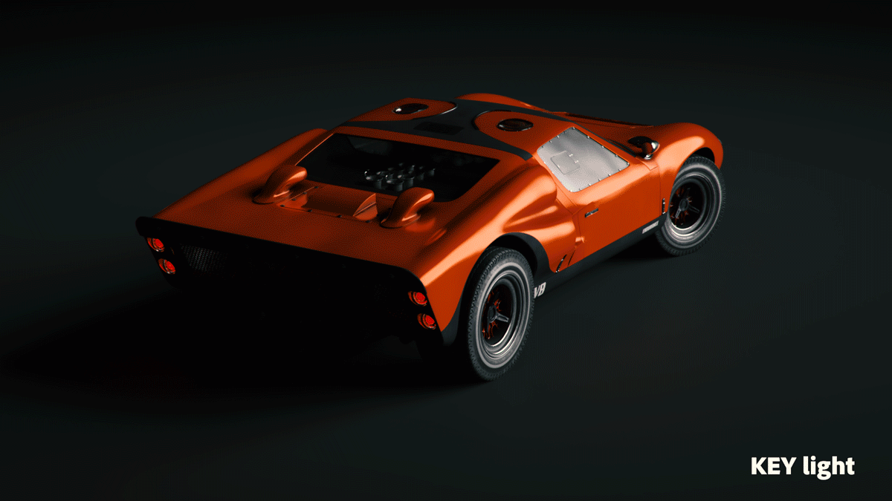

Ein weiterer nützlicher Trick ist es, eine Kugel mit einem glänzenden metallischen Material (einem Chrom oder einem Spiegel) zu erstellen. Diese &quot;Spiegelkugel&quot; reflektiert die gesamte Szene um das Licht herum, sodass du Position, Richtung und Größe des Lichts auf einfache Weise bestimmen kannst. Bei Umgebungslichtern kannst du ihre Spiegelung in der Spiegelkugel sehen, was dazu beiträgt, die Raumausrichtung festzulegen.

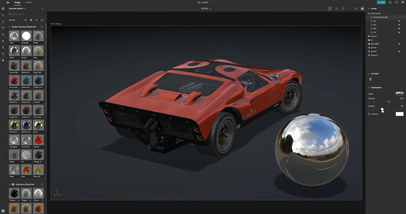

## Lichtarten auf Adobe [!DNL Dimension]

### Umgebungslichter

Umgebungslichter sind äquirektanguläre (kugelförmige) Bilder, die um die gesamte Szene gewickelt werden. Wie der Name schon sagt, dienen diese Lichter dazu, die gesamte Umgebung zu emulieren, einschließlich der Lichtquellen, die in ihnen gespeichert sind.

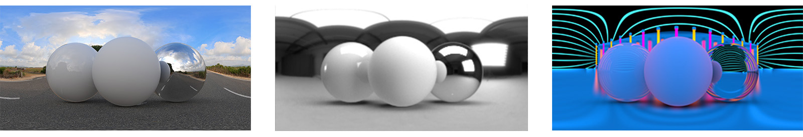

Wenn Sie eine neue Szene in [[!DNL Dimension]](https://www.adobe.com/products/dimension.html) erstellen, wird ein standardmäßiges Umgebungslicht für Sie erstellt. Das ist der Grund, warum man sofort etwas in der Szene sehen kann. Adobe [!DNL Dimension] Starter Assets enthalten eine bestimmte Anzahl von Umgebungslichtern, die Sie sofort ausprobieren können. Darüber hinaus bietet [Adobe [!DNL Stock]](https://stock.adobe.com/search?filters[content_type:3d]=1&filters[3d_type_id]&#x200B;[0]=2&load_type=3d+lp) eine große, kuratierte Auswahl an Umgebungslichtern.

Umgebungslichts liefern äußerst realistische Ergebnisse und sparen Ihnen dadurch viel Zeit. Um etwas Ähnliches manuell zu erreichen, müssten Sie tatsächlich die gesamte Umgebung in 3D (einschließlich verschiedener Lichtquellen) erstellen, was ein erheblicher Arbeitsaufwand ist.

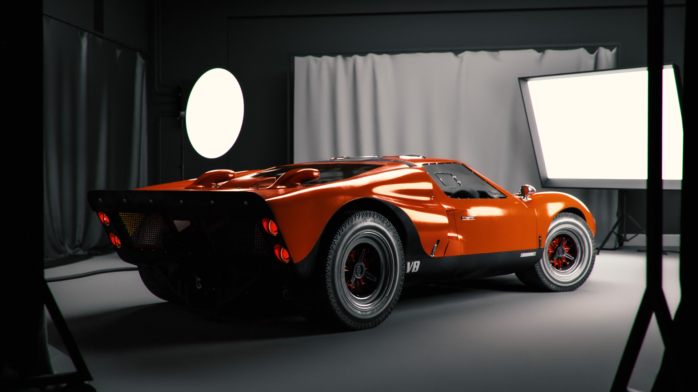

Es gibt viele Möglichkeiten, Umgebungslichts zu erstellen, zum Beispiel durch Aufnahme aus einer 3D-Szene, aus einem Foto oder mithilfe von parametrischen Systemen. Wenn das Umgebungslicht aus einer 3D-Szene besteht, ist der Prozess einfach. Das Ausgabebild muss 32 Bit groß sein. Damit werden die Lichtinformationen aller Lichter in der Szene erfasst. Die 3D-Kamera muss die äquirektanguläre Projektion verwenden (um ein kugelförmiges Bild auszugeben).

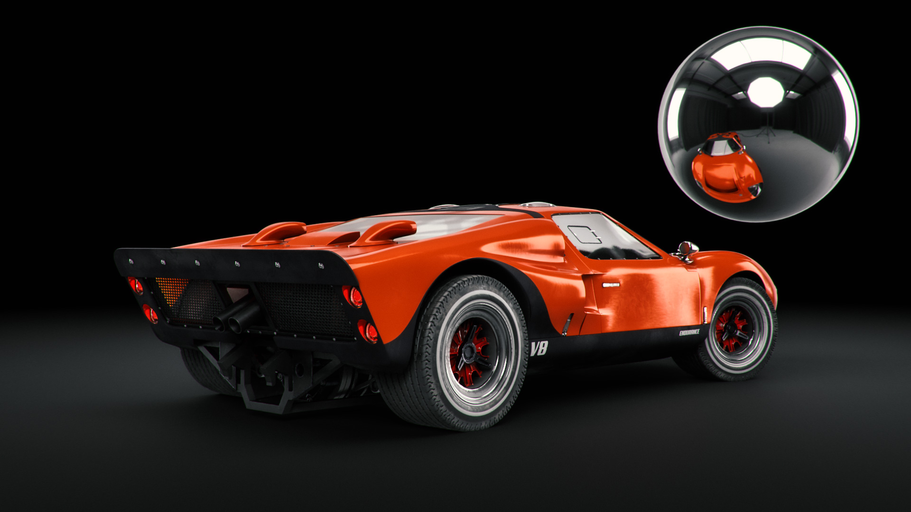

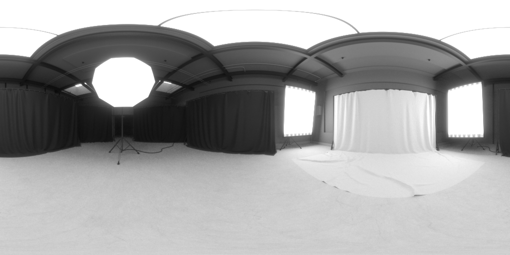

Du kannst Umgebungslichts auch erstellen, indem du Fotos aus der realen Welt aufnimmst. Für diesen Workflow ist eine 360-Grad-Kamera erforderlich (z. B. [Ricoh Theta Z1](https://theta360.com/en/about/theta/z1.html)). Die Kamera wird dann für Belichtungsreihen verwendet oder für mehrere Aufnahmen derselben Umgebung, die mit einer Reihe verschiedener Belichtungswerte (von unterbelichtet bis überbelichtet) aufgenommen wurden. Diese Aufnahmen werden dann verwendet, um 32-Bit-Bilder zu erstellen, die oft als HDR bezeichnet werden (kurz für eine High Dynamic Range). Mit der Funktion &quot;Zu HDR zusammenfügen&quot; in Photoshop lässt sich ein solches Bild beispielsweise zusammensetzen. Der eingebettete Belichtungsbereich wird zur Intensitätseigenschaft.

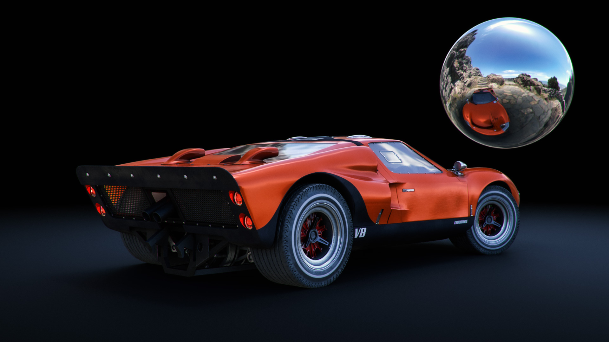

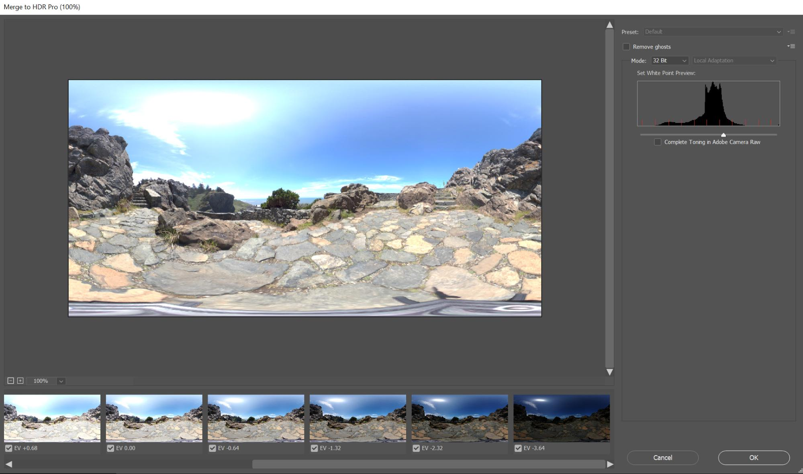

In beiden Fällen werden die Lichtquellen (und ihre Intensitäten) in diese Bilder &quot;Baking geführt&quot; und emittieren das Licht, sobald sie in [!DNL Dimension] verwendet werden.

Mit diesen Methoden hast du die gesamte Beleuchtung, Reflexionen und Details erfasst, aber mit 3D-Apps kannst du sie im 3D-Raum weiter bearbeiten, sodass du die Drehung der Beleuchtung anpassen und die Gesamtintensität und -farbe ändern kannst.

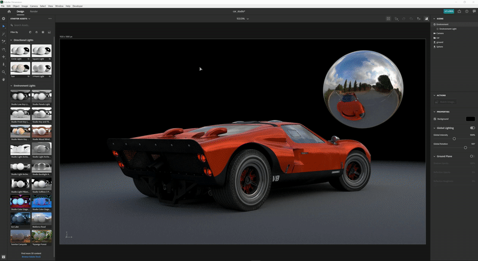

### Richtungsleuchten

Neben Umgebungslichtern, die Licht von 360 Grad aussenden, gibt es auch Richtungslichter, die Licht nur aus einer Richtung aussenden. Sie werden verwendet, um Taschenlampen und andere Arten von Lichtern zu emulieren, die von einem gut definierten Emitter kommen, und sie können als Kreis oder als Quadrat geformt werden.

Die Verwendung von Richtlichtern bietet vollständige Kontrolle über die Beleuchtungskonfiguration. Die Beleuchtung der Szene erfolgt mit diesen Lichtquellen auf die gleiche Weise wie bei der herkömmlichen Fotografie, bei der jede Lichtquelle unabhängig voneinander angesteuert werden kann, sodass du dir eine eigene virtuelle fotografische Beleuchtung aufbauen kannst. Eine der am häufigsten verwendeten Beleuchtungskonfigurationen ist das 3-Punkt-Lichtsystem.

[!DNL Dimension] verfügt über eine praktische Aktion &quot;Licht auf Punkt richten&quot;, mit der Sie die Drehung und das Height steuern können, indem Sie einfach auf ein 3D-Objekt klicken und über dieses ziehen. Auf diese Weise können Sie die Lichtstrahlen dynamisch lenken. Diese Parameter können auch manuell eingestellt werden.

Sie können die Farbe und die Intensität der Richtungslichter ändern und die Form der Lichtquelle anpassen - sie kreisförmig oder rechteckig machen, sie gedehnt oder größer machen. Zum Schluss kannst du die Kanten der Lichtquelle weichzeichnen.

![Ändern der Form eines Richtungslichts auf Adobe [!DNL Dimension]](assets/Mastering3dlighting_12.gif)

Wenn du die Lichtquelle kleiner machst als das Objekt, werden die Schatten schärfer, mit einem schärferen Umriss, weil die Strahlen nicht an dem beleuchteten Objekt vorbeikommen können. Größere Lichtquellen erzeugen weichere Schatten, da die Strahlen in diesem Fall von allen Seiten des Objekts kommen (in der Abbildung unten rot markiert), was eine Reihe von Schatten erzeugt. Diese Schatten werden durch die Strahlen, die aus der entgegengesetzten Richtung kommen, weicher.

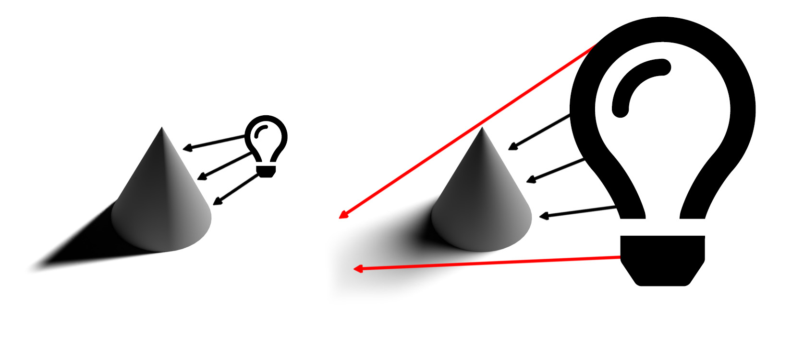

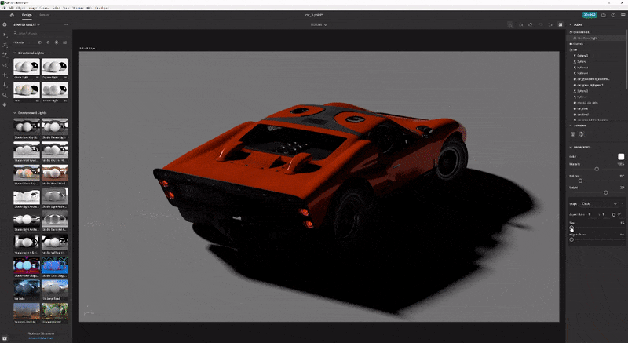

### Sonne und Himmel

Sonnenlicht ist eine spezielle Art von gerichtetem Licht. Die Einrichtung erfolgt ähnlich wie bei einem normalen Licht, jedoch ändert dieses Licht automatisch die Farbgebung mit Height. Wenn es sich in der Nähe des Horizonts befindet (niedrige Height-Winkel), wird es allmählich wärmer, um den Sonnenuntergang zu simulieren. Die Farbe kann auch mithilfe von Vorgaben geändert werden. In der Zwischenzeit wird der Schatten durch Wolken weicher.

![Bearbeiten von Beleuchtungseigenschaften für Sonnenlicht auf einem 3D-Automodell in Adobe [!DNL Dimension]](assets/Mastering3dlighting_15.gif)

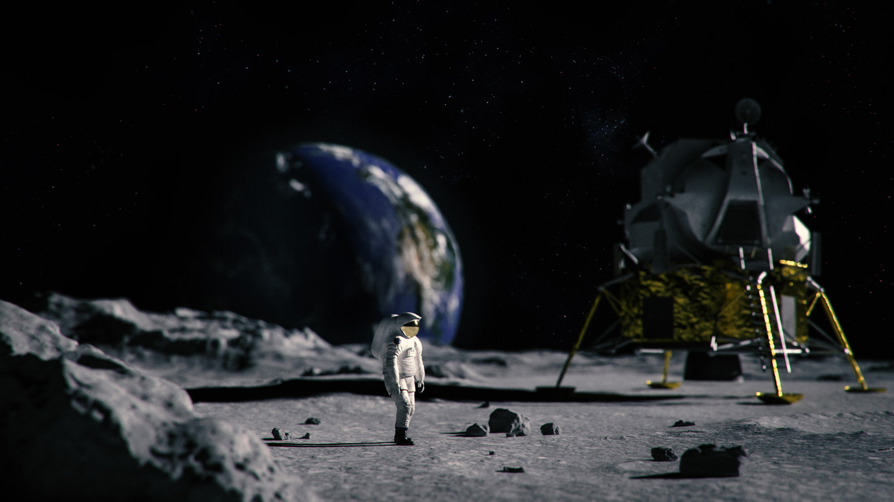

Wir können den Himmel mit Umgebungslichtern nachahmen, und jedes Umgebungslicht mit diesem Himmel kann verwendet werden. Jetzt müssen wir das Sonnenlicht (hergestellt in [!DNL Dimension]) auf die Sonne ausrichten, die im Umgebungslicht aufgenommen wurde. Eine schnelle Möglichkeit hierfür ist, eine Kugel zu erstellen und ihr ein metallisches Material zuzuweisen. Dadurch erhalten wir Reflexionen der Umgebung in Echtzeit, sodass wir das Ziellicht an einem Punkt verwenden können, um das Sonnenlicht an der Sonne auszurichten.

Bei bewölktem Himmel kann die Eigenschaft &quot;Bewölkung&quot; verwendet werden, um diese Bedingungen genauer abzugleichen.

![Bearbeiten von Wolkeneigenschaften für die Beleuchtung der Himmelsumgebung auf einem 3D-Automodell in Adobe [!DNL Dimension]](assets/Mastering3dlighting_17.gif)

Sobald das Sonnenlicht- und das Himmel-Umgebungslicht gepaart sind, können Sie sie gemeinsam drehen, indem Sie die Eigenschaft &quot;Globale Drehung&quot; verwenden.

### Objektbasierte Lichter

Sie können Objekte in Lichtquellen umwandeln, indem Sie die Eigenschaft &quot;Glühen&quot; für ihre Materials aktivieren. Auf diese Weise ist es möglich, Objekte wie Glühbirnen, Neonleuchten, Softboxen und alle Arten von Bildschirmen und Displays zu erstellen.

Der Hauptvorteil dieser Art der Beleuchtung ist der Intensitätsabfall, der zu sehr natürlichen Ergebnissen führt. Dies ist sehr nützlich für die Produktvisualisierung oder andere studiobasierte Szenen.

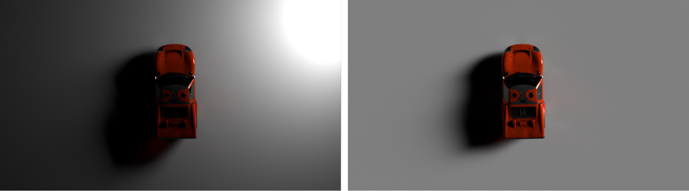

Sie können die Weichheit der Schatten steuern, indem Sie das leuchtende Objekt mit dem Transformationswerkzeug nach oben oder unten skalieren. Wenn du den Regler vergrößerst, wird auch die Lichtintensität erhöht.

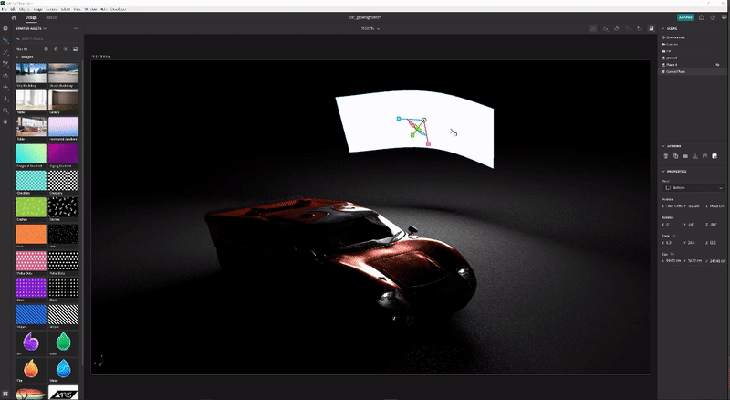

Anders als bei den bisherigen Lichtarten, die wir abgedeckt haben, können diese zusätzlich zu den Standardfarben auch Texturen verwenden. Die Texturen können an der Grundfarbe ihrer Materialien befestigt werden, und die Lichtintensität wird über einen Glühregler geregelt.

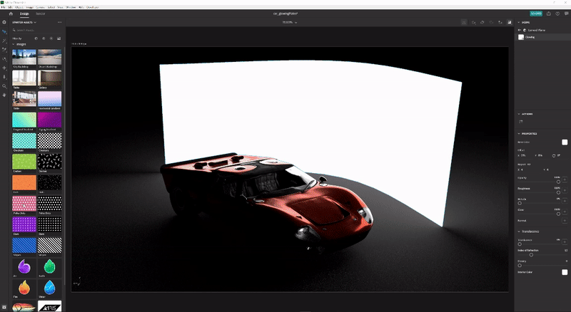

## Beispiele für effektive 3D-Beleuchtung

### Produktbeleuchtung

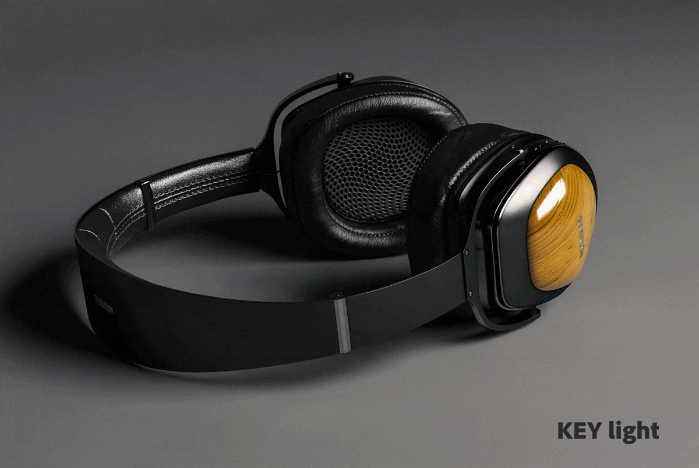

Es gibt viele fotografische Techniken, um das Licht für eine Produktaufnahme einzurichten. Wir werden eine der am häufigsten verwendeten Einstellungen verwenden, nämlich das 3-Punkt-Lichtsystem.

Diese Einrichtung besteht aus drei Lichtern:

1. **Hauptlicht:** als Hauptquelle verwendet, scheint ungefähr von der Kamera aus

   

1. **Randlicht:**, das auf der gegenüberliegenden Seite der Taste ausgerichtet ist, wird verwendet, um die Silhouette des Motivs legen.

   

1. **Fülllicht:** weniger intensiv und dient zum Füllen dunklerer Bereiche. Dies wird für Bereiche verwendet, die die beiden vorherigen Lichter nicht erreichen.

   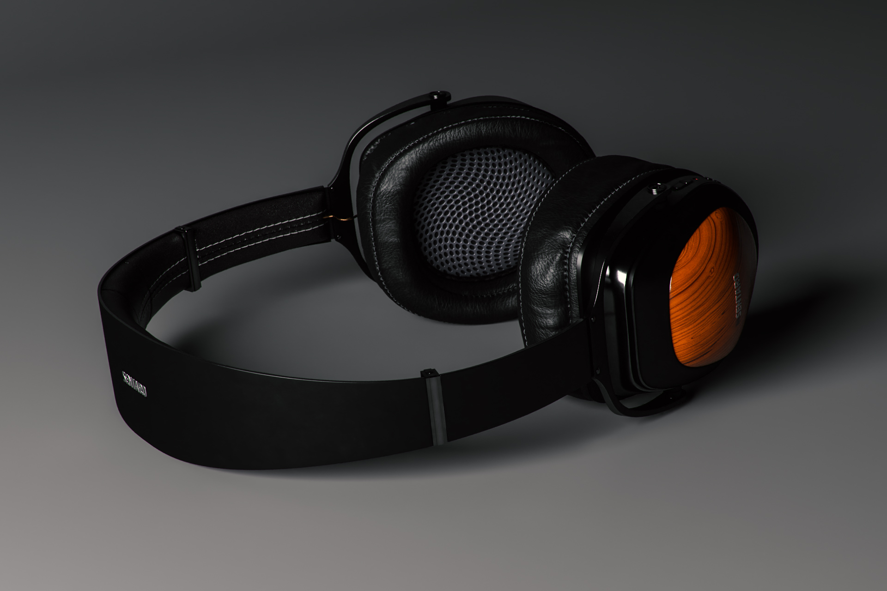

Es gibt zwei Möglichkeiten, die 3-Punkt-Beleuchtung in [!DNL Dimension] zu erstellen: mit Richtungslichtern (einzeln Hinzufügen zur Szene oder mit einer 3-Punkt-Lichtvorgabe) oder über leuchtende Objekte.

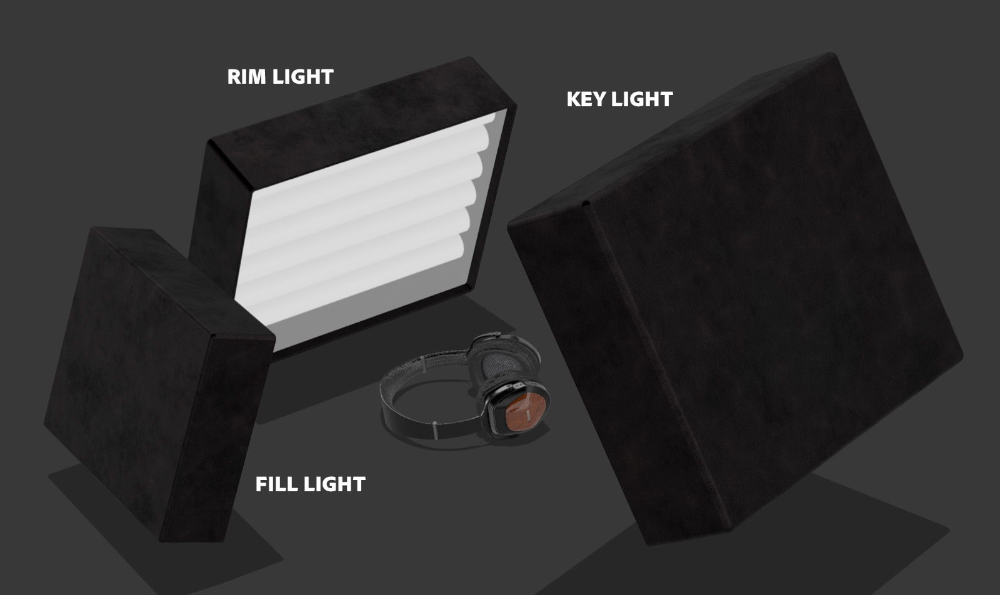

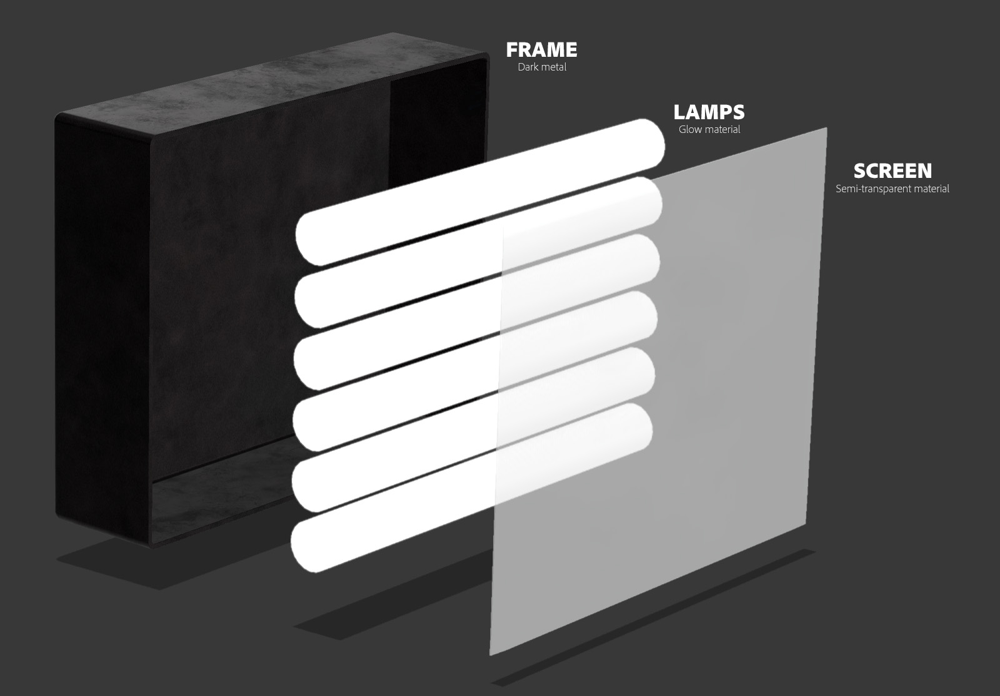

### Kreative Beleuchtung

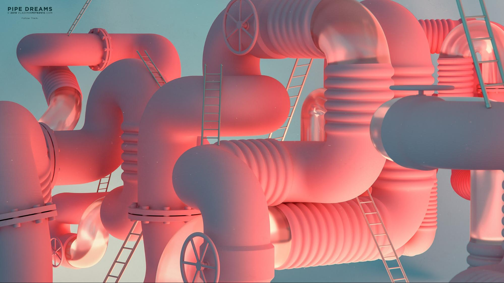

Kreative Beleuchtung kommt zum Einsatz, wenn die physische Präzision nicht das Hauptziel ist. Dies schließt abstrakte und surreale Szenen aller Art ein, sodass es keine wirklichen Grenzen gibt, an die unsere Vorstellungen uns heranführen können.

Im obigen Beispiel sollte eine traumhafte Umgebung abgebildet werden: Süßigkeiten, Pastellfarben und glatte Oberflächen. Das Beleuchtungssystem besteht aus drei glühenden Platten (zwei auf der Seite und die Hauptleuchtplatte von unten). Alle leuchtenden Platten sind unrealistisch groß, was sehr glatte Schatten und Glanzlichter erzeugt. Die Lichtquellen werden eingefärbt und diese Farbe wird in das den Objekten in der Szene zugeordnete Material übertragen.

Das Motiv der Szene (Rohre) ist vollständig von der Wandgeometrie umgeben. Das führt dazu, dass die Lichtstrahlen hin und her reflektiert werden und sich auf interessante Weise vermischen. Das Spielen mit kalten VS-Warmtönen erzeugt oft einen schönen Kontrast (diese Technik wird manchmal in der Porträtfotografie verwendet).

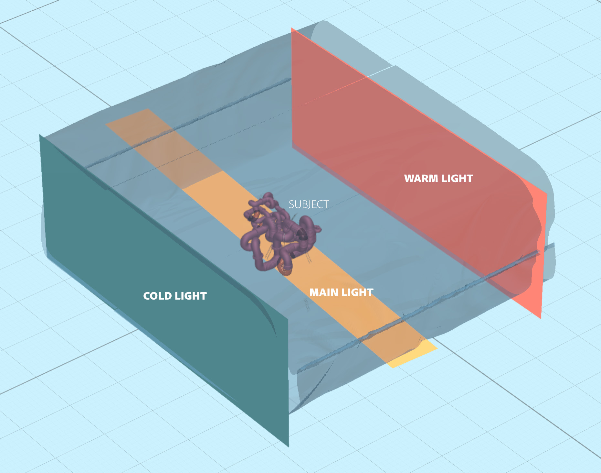

### Visualisierung des Innenraums

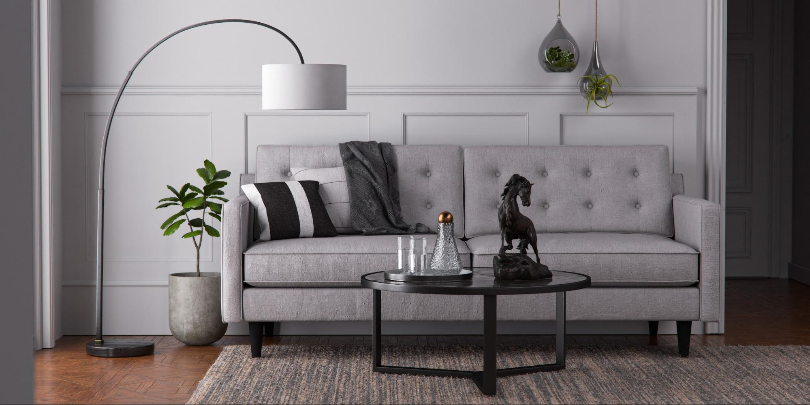

Die Visualisierung eines 3D-Innenraums folgt bestimmten Regeln, die fast immer gute Ergebnisse garantieren. Für diesen Anwendungsfall berücksichtigen wir nur natürliches Licht (keine künstlichen Quellen, wie Lampen).

Vor allem muss eine solche Szene in einer geschlossenen Umgebung sein. Wie im echten Leben braucht der Innenraum Wände, Boden, Decke und Fenster. Dadurch wird sichergestellt, dass das Licht durch die Fenster einfällt und dann (über einen Prozess namens &quot;Raytracing&quot;) umspringt. Dieses Verhalten erzeugt eine sehr natürliche Beleuchtung (zum Beispiel sind die verdeckten Bereiche, wie Ecken, dunkler).

Da die Szene fast vollständig von architektonischer Geometrie umgeben ist, werden wir sehr wenig Beleuchtung und fast keine Reflexionen aus dem Umgebungslicht sehen. Aber in diesem Fall bauen wir tatsächlich unsere eigene Umwelt auf, nämlich den Innenraum selbst. Das Licht reagiert auf die Objekte in der Szene, indem es von ihnen und den umgebenden Wänden reflektiert wird. Die Objekte reflektieren nur einander und die Wände um sie herum. Trotzdem ist es eine gute Idee, ein Umgebungslicht mit dem Himmel hinzuzufügen. Dadurch entsteht eine diffuse blaue Füllung.

Die einfachste Möglichkeit, dieses Licht einzustellen, besteht darin, Ebenen mit leuchtenden Materialien zu verwenden. In diesem Anwendungsfall haben wir drei Ebenen, die alle Öffnungen im Inneren abdecken.

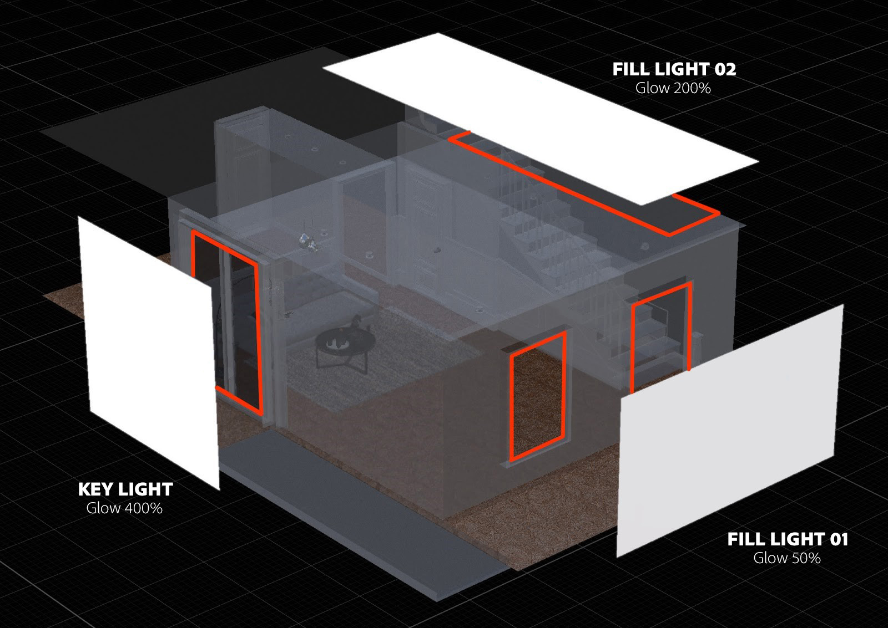

Die Lichtintensität wird über die Eigenschaft &quot;Glühen&quot; in den Materialien der Ebenen festgelegt. Sie können eine Farbe oder sogar eine Textur hinzufügen, mit der interessante Schatten Geworfen werden können. Die Verwendung von Glow-Materialien sorgt auch für den Abfall der Lichtintensität, der für die Innenbeleuchtung sehr wichtig ist.

### Außenbeleuchtung

Das Erstellen von Außenbeleuchtung ist ziemlich einfach und es kommt auf die Verwendung eines Sun- und Sky-Lichtsystems (siehe oben). Es ist wichtig, das Sonnenlicht korrekt an das himmelbasierte Umgebungslicht anzupassen - und dabei sowohl die Ausrichtung als auch den Bewölkungswert zu beachten.

Die Szene selbst spielt dabei eine große Rolle. Um überzeugende Ergebnisse zu erzielen, verwende Objekte in deiner Szene als Katalysatoren, die mit dem Licht interagieren. Beim oben gezeigten Waldrendering werden die Objekte (verschiedene Pflanzen, Stämme und Bäume) dicht beieinander platziert.

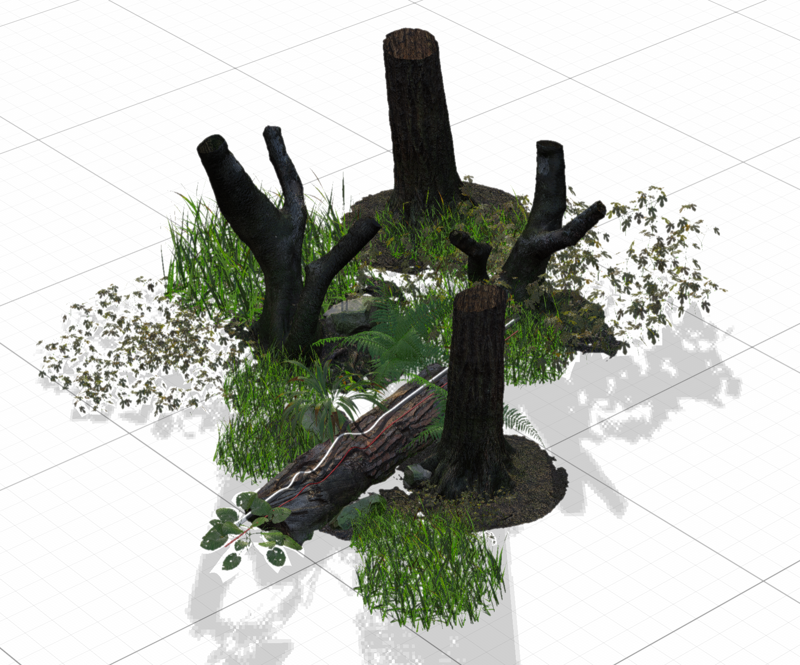

Das bedeutet, dass es eine Menge komplexer Lichtinteraktionen gibt, da das Raytracing zwischen den Objekten reflektiert wird. Schattierte Flecken erscheinen (wie erwartet) dunkel, während gelegt Bereiche hell bleiben.

![Verwenden der globalen Drehung in Adobe [!DNL Dimension], um das Sun- und Sky-Lichtsystem in einer 3D-Szene neu auszurichten](assets/Mastering3dlighting_34.gif)

Ich hoffe, dieser Überblick zeigt, wie wichtig es ist, 3D-Lichter in verschiedenen Situationen zu beherrschen. Du solltest anfangen, überzeugendere Ergebnisse zu erzielen.

Alles Gute zur Beleuchtung! Laden Sie noch heute die [neueste Version](https://creativecloud.adobe.com/apps/download/Dimension) der Dimension herunter.
