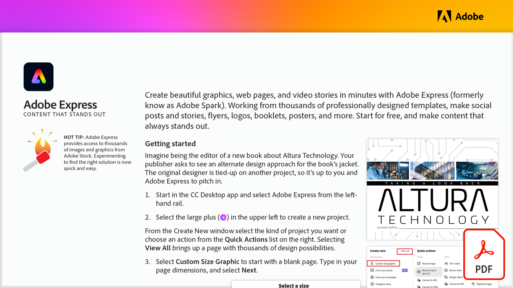

# Adobe Expreß: Content, der heraussticht

Erstelle Grafiken, Websites und Video-Storys in Minuten mit Adobe Expreß (früher Adobe Spark). Mit professionellen Templates erstellst du Social-Media-Posts und Storys, Flyer, Logos, Broschüren oder Poster. Kostenlos nutzen und überzeugenden Content gestalten.

Wählen Sie die Abbildung unten, um dieses PDF-Tutorial anzuzeigen oder herunterzuladen.

[{width="680"}](assets/Adobe-Express-content-that-stands-out.pdf){target="blank"}
