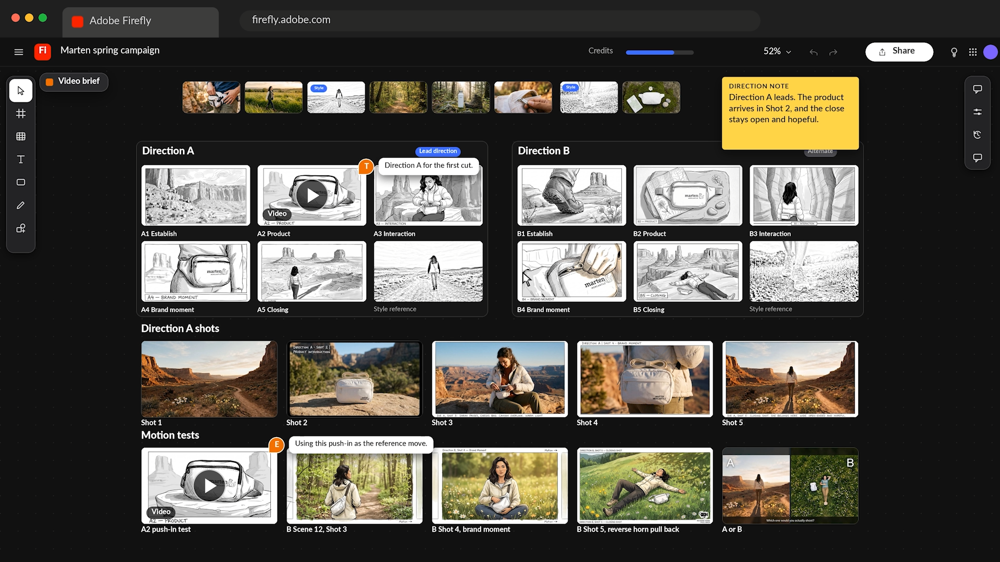

# Creative Cloud für Unternehmen - KI-Tutorials.

Entdecke Tutorials, die dir helfen können, Ideen zu entdecken, Inhalte zu erstellen und kreative Workflows mit KI auf dem Creative Cloud zu optimieren. Diese Tutorials sind nach Rollen gruppiert: Graphic Designer, Creative/Art Director, Photoshop Artist/Retoucher und Video Editor.

## Graphic Designer

<table style="table-layout:fixed">
<tr>
 <td>
   
    

   <a href="turn-flat-vector-art.md"><strong>Flache Vektorgrafiken in einen beliebigen Winkel umwandeln - ohne sie neu zu zeichnen</strong></a>
    

    <em>Erfahren Sie, wie Sie Text-zu-Muster in Illustrator verwenden</em>
     
  </td>
  <td>
   
    

   <a href="seamless-vector.md"><strong>Nahtlose Vektormuster in Minuten, nicht Stunden</strong></a>
    

    <em>Erfahren Sie, wie Sie in Illustrator ein nahtloses Branding-Muster erstellen, ohne jede Wiederholungskante von Hand prüfen zu müssen</em>
     
  </td>
  <td>
    
    

     
  </td>
  <td>
    
    

     
  </td>
</tr>
</table>

## Creative/Art Director

<table style="table-layout:fixed">
<tr>
  <td>
   
    

   <a href="one-brief.md"><strong>20 Wegbeschreibungen aus einem Brief vor dem Mittagessen</strong></a>
    

    <em>Erfahren Sie, wie Sie einen kreativen Auftrag in ein gemeinsames Board mit starken visuellen Richtungen verwandeln</em>
     
  </td>
  <td>
    
    

     
  </td>
  <td>
    
    

     
  </td>
  <td>
    
    

     
  </td>
</tr>
</table>

## Photoshop Artist/Retoucher

<table style="table-layout:fixed">
<tr>
  <td>
   
    

   <a href="retouch-faster.md"><strong>Schneller retuschieren und die Originalpixel beibehalten</strong></a>
    

    <em>Erfahren Sie, wie Sie einem Produktfoto in Photoshop natürliche Schatten hinzufügen, während Ihre Originalpixel intakt bleiben</em>
     
  </td>
  <td>
    
    

     
  </td>
  <td>
    
    

     
  </td>
  <td>
    
    

     
  </td>
</tr>
</table>

