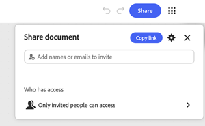
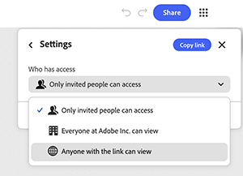
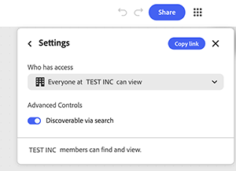
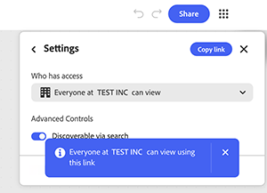
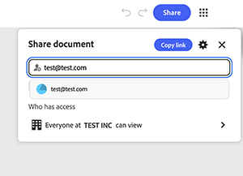
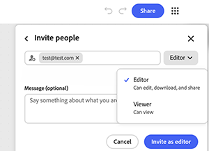
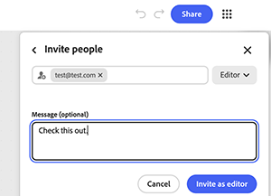

# &#x200B;5. Freigeben eines Grafen

Erfahren Sie, wie Sie einen Graf für andere freigeben. Wenn Sie einen Graf freigeben, wird nicht nur die Ausgabe, sondern auch der Live-Arbeitsablauf freigegeben. Jeder mit Bearbeitungszugriff kann sie erneut ausführen, ändern und an eine andere Person übergeben. Verwenden Sie den Zugriff auf Linkebene für eine breite Sichtbarkeit innerhalb des Unternehmens und nennen Sie Einladungen mit einer bestimmten Rolle für jeden, der direkten Zugriff benötigt.

1. Wählen Sie **Freigeben** in der oberen rechten Ecke des Grafen aus.

   Das Dialogfeld wird mit einem Feld zum Hinzufügen von Namen oder E-Mails und einer Übersicht darüber geöffnet, wer derzeit Zugriff hat. Standardmäßig können nur eingeladene Personen auf den Graf zugreifen.

   

1. Wählen Sie das Zahnradsymbol aus, um **Einstellungen** zu öffnen, und wählen Sie **Jeder bei [Unternehmen] kann** anzeigen, damit jeder im Unternehmen den Graf mit dem Link öffnen kann.

   

   Es stehen drei Zugriffsebenen zur Verfügung: nur eingeladene Personen, alle Mitarbeiter der Organisation oder jede Person mit dem Link.

1. Aktivieren Sie die Option **Über Suche auffindbar**, damit Mitglieder den Graf finden können, ohne den Link überhaupt zu benötigen.

   

   In einem Bestätigungsbanner wird genau angegeben, wer den Graf über den Link anzeigen kann. Überprüfen Sie dies, bevor Sie den Link an eine beliebige Stelle senden. Es gilt für jeden zukünftigen Empfänger dieses Links, nicht nur für die nächste eingeladene Person.

   

1. Geben Sie eine E-Mail-Adresse direkt in das Einladungsfeld ein, um einer Person separat von der Einstellung für allgemeine Links einen personengebundenen Zugriff zu gewähren. Wählen Sie den zugehörigen Eintrag aus dem Vorschlag aus, der unter dem Feld angezeigt wird.

   

1. Wählen Sie die Dropdown-Liste neben ihrem Namen aus, um **Editor** oder **Viewer** auszuwählen.

   

   Der Editor kann den Graf bearbeiten, herunterladen und freigeben. Der Viewer kann es nur anzeigen. Wählen Sie die schmalere Rolle aus, es sei denn, die Person muss den Graf selbst ändern.

1. Fügen Sie im Feld **Nachricht** eine optionale Notiz hinzu, damit der Empfänger weiß, warum er Zugriff erhält. Wählen Sie **Als Editor einladen** oder **Als Viewer einladen**, wenn diese Rolle ausgewählt wurde, um sie zu senden.

   

## Nächster Schritt

Sie möchten mit einer Vorlage beginnen? Wechseln Sie zu [5. Passen Sie eine Vorlage &#x200B;](https://experienceleague.adobe.com/en/docs/creative-cloud-enterprise-learn/cce-learning-hub/fireflyoverview/firefly-graph/customize-template) an, damit sie Ihren eigenen Auftrag widerspiegelt.

Zurück zu [Erste Schritte mit Firefly Graph](https://experienceleague.adobe.com/en/docs/creative-cloud-enterprise-learn/cce-learning-hub/fireflyoverview/firefly-graph/overview-firefly-graph).