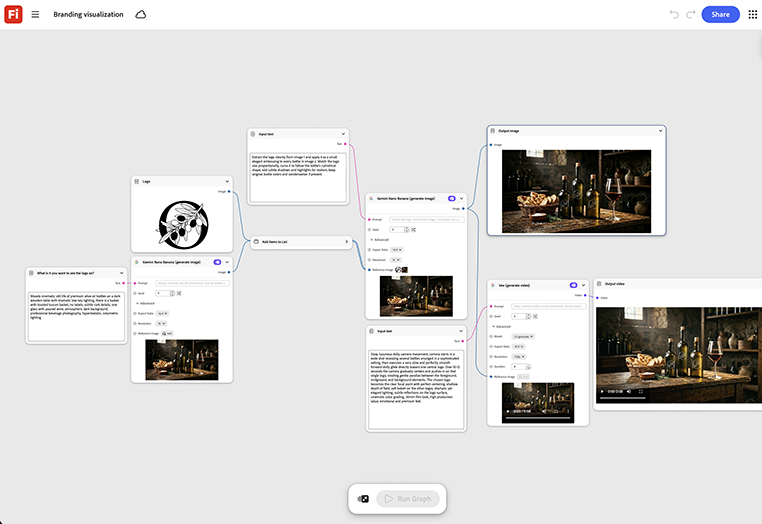

# Branding-Visualisierung

Erfahrt, wie ihr euer Logo oder eure Marke in Produkt-Szenen visualisieren könnt. Definiert Markenrichtlinien oder eine Logo- und Farbpalette. Dabei werden die Graphausgaben von static key art und short motion in einem Durchgang übernommen. So bleiben beide Formate optisch aufeinander abgestimmt.[Branding-Visualisierungsvorlage öffnen](https://firefly.adobe.com/graph/edit/id/urn:aaid:sc:US:c11ecbe0-0751-58ce-9f30-2eb6518bfd51).

[!BADGE Branchenbeispiele]{type=Informative tooltip="Beispiele aus der Branche"}

* **Tech** - Visualisieren Sie eine neue Produkt-Untermarke sowohl als Schlüsselgrafik als auch als Launch-Teaser, bevor Sie das Design- oder Medienbudget in die vollständige Produktion aufnehmen.
* **Getränke** - Testen Sie drei Logo- und Farbpalettenrichtungen als fertige Schlüsselgrafik, bevor Sie eine für die Produktion auswählen.
* **Finanzen** - Zeigen Sie eine Vorschau einer neuen Karte oder App-Identität als visuelle Elemente mit Branding an, bevor sie einen Design-Review erreicht.

>[!TIP]
>
>**Bevor Sie beginnen** - Um optimale Ergebnisse zu erzielen, passen Sie diese Vorlage an Ihr eigenes Branding, Produkt und Ihren eigenen Workflow an. Tauschen Sie Ihre Referenzbilder, Eingabeaufforderungen und Texte ein, bevor Sie eine Ausgabe verwenden.

{align="center"}

Zurück zu [Erste Schritte mit Firefly Graph](https://experienceleague.adobe.com/de/docs/creative-cloud-enterprise-learn/cce-learning-hub/fireflyoverview/firefly-graph/overview-firefly-graph).
