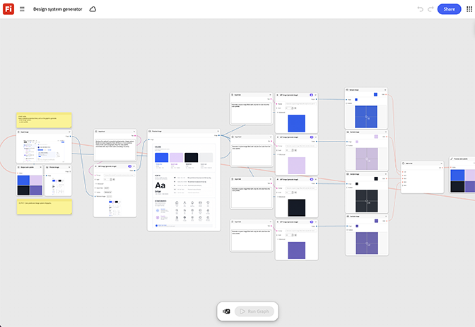

# Entwurfssystemgenerator

Lerne, wie du ein Design-System anhand eines Website-Screenshots erstellst. Der Graf erzeugt einen übereinstimmenden Satz von Symbolen, Mustern und Layoutkomponenten in einem einzigen Batchlauf. [Systemgenerator für den Entwurf öffnen](https://firefly.adobe.com/graph/edit/id/urn:aaid:sc:US:b40cd34c-66b2-586c-ab4a-5595490cded6).

[!BADGE Branchenbeispiele]{type=Informative tooltip="Beispiele aus der Branche"}

* **Tech** - Generieren Sie einen wiederverwendbaren Satz von Symbolen und Hintergrundmustern für einen vierteljährlichen Funktionsstart, der für Anzeigen, Landingpages und Social Media wiederverwendet wird, ohne das Design erneut zu besprechen.
* **Finanzen** - Erstellen Sie ein konsistentes Symbol- und Farbsystem für eine neue App-Neugestaltung, bevor die Entwicklung beginnt.
* **Kommunikation und Telekommunikation** - Generieren Sie eine passende visuelle Sprache für eine neue Abo-Ebene über Web- und Ladenbeschilderung.

>[!TIP]
>
>**Bevor Sie beginnen** - Um optimale Ergebnisse zu erzielen, passen Sie diese Vorlage an Ihr eigenes Branding, Produkt und Ihren eigenen Workflow an. Tauschen Sie Ihre Referenzbilder, Eingabeaufforderungen und Texte ein, bevor Sie eine Ausgabe verwenden.

{align="center"}

Zurück zu [Erste Schritte mit Firefly Graph](https://experienceleague.adobe.com/en/docs/creative-cloud-enterprise-learn/cce-learning-hub/fireflyoverview/firefly-graph/overview-firefly-graph).
