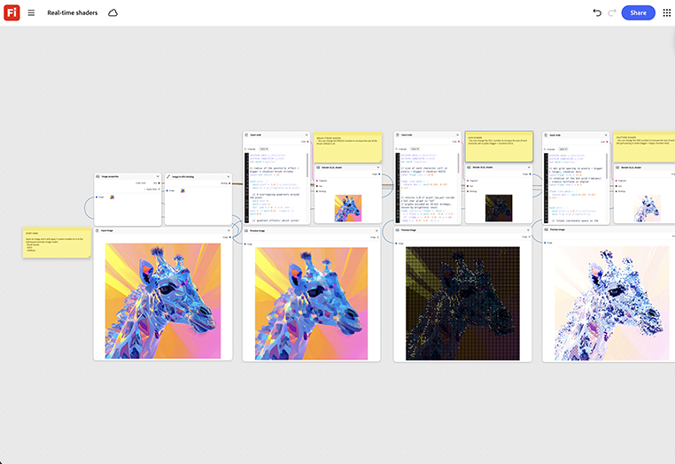

# Echtzeit-Shader

Lerne, wie du mit einem Bild beginnst und drei verschiedene benutzerdefinierte Shader anwendest und das Ergebnis in Echtzeit in der Vorschau anzeigst. Passen Sie die Shader-Parameter direkt auf dem Node an, anstatt das Rendering von Grund auf neu durchzuführen. [Echtzeitschattenvorlage öffnen](https://firefly.adobe.com/graph/edit/id/urn:aaid:sc:US:51848c67-e360-5c40-8eff-8517b3395d54).

[!BADGE Branchenbeispiele]{type=Informative tooltip="Beispiele aus der Branche"}

* **Tech** - Erstellen Sie einen benutzerdefinierten stilisierten Shader, der nach einem 3D-Produktkonfigurator sucht, der in einer interaktiven Messedemo verwendet wird.
* **Automotive** - Zeigen Sie eine Vorschau benutzerdefinierter Malen- und Material-Shader auf einem Fahrzeugmodell an, bevor ein physischer Prototyp vorhanden ist.
* **Einzelhandel** - Testen Sie stilisiertes Material auf einem 3D-Produkt-Rendering für ein digitales Regal-Display.

>[!TIP]
>
>**Bevor Sie beginnen** - Um optimale Ergebnisse zu erzielen, passen Sie diese Vorlage an Ihr eigenes Branding, Produkt und Ihren eigenen Workflow an. Tauschen Sie Ihre Referenzbilder, Eingabeaufforderungen und Texte ein, bevor Sie eine Ausgabe verwenden.

{align="center"}

Zurück zu [Erste Schritte mit Firefly Graph](https://experienceleague.adobe.com/de/docs/creative-cloud-enterprise-learn/cce-learning-hub/fireflyoverview/firefly-graph/overview-firefly-graph).
