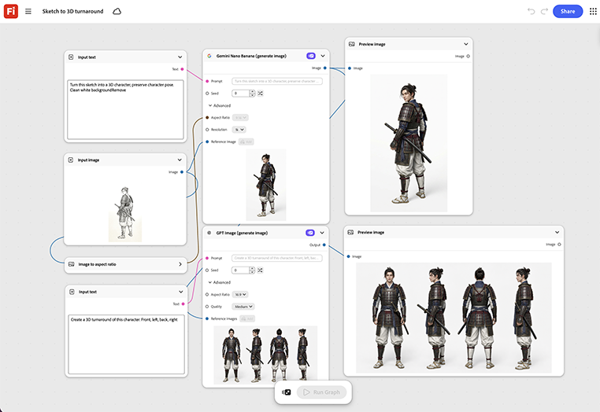

# Umschwung von Skizze in 3D

Lerne, wie du eine Skizze in eine 3D-Figur verwandelst. Der Graf erstellt daraus eine rotierende 3D-Kehrtwende, die vor jedem physischen Prototyp für eine interne Design-Überprüfung bereit ist. [Vorlage zum Öffnen der Sketch-in-3D-Bearbeitung](https://firefly.adobe.com/graph/edit/id/urn:aaid:sc:US:984a5ded-67e1-5a78-9283-52a0126bf8b2).

[!BADGE Branchenbeispiele]{type=Informative tooltip="Beispiele aus der Branche"}

* **Tech** - Verwandeln Sie eine frühe Hardwarekonzeptionsskizze in eine 3D-Wende für den Design-Review, bevor Sie einen Commit für einen physischen Prototypenbuild ausführen.
* **Automotive** - Visualisieren Sie eine frühe Fahrzeugkonzeptionsskizze als sich drehende 3D-Kehrtwende für die interne Überprüfung.
* **Unterhaltung** - Verwandeln Sie eine Figurenskizze in eine 3D-Kehrtwende für ein Pitchdeck.

>[!TIP]
>
>**Bevor Sie beginnen** - Um optimale Ergebnisse zu erzielen, passen Sie diese Vorlage an Ihr eigenes Branding, Produkt und Ihren eigenen Workflow an. Tauschen Sie Ihre Referenzbilder, Eingabeaufforderungen und Texte ein, bevor Sie eine Ausgabe verwenden.

{align="center"}

Zurück zu [Erste Schritte mit Firefly Graph](https://experienceleague.adobe.com/en/docs/creative-cloud-enterprise-learn/cce-learning-hub/fireflyoverview/firefly-graph/overview-firefly-graph).
