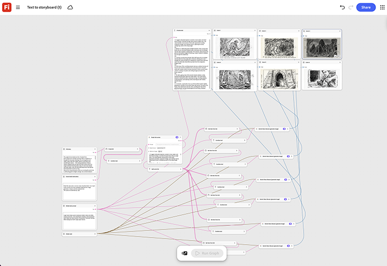

# Text in Storyboard

Erfahren Sie, wie Sie ein Storyboard aus einem Skript oder einer Aufnahmeliste generieren. Jede Zeile wird zu einem eigenen Storyboard-Rahmen, der nacheinander generiert und für den Review als ein einziger Bedienfeldsatz ausgelegt wird. [Text zu Storyboard-Vorlage öffnen](https://firefly.adobe.com/graph/edit/id/urn:aaid:sc:US:8c4d6b7f-a9b6-503c-8a7e-c06cb5cc4ce2).

[!BADGE Branchenbeispiele]{type=Informative tooltip="Beispiele aus der Branche"}

* **Finanzen** - Wandeln Sie ein genehmigtes Skript für ein neues Sparprodukt in ein Storyboard um, das die Agentur am selben Tag mit rechtskräftigen Signaturen auf der Kopie aufnehmen kann.
* **Einzelhandel** - Storyboard ein Produkteinführungsvideo direkt aus dem Kampagnenbrief, bevor ein Director gebucht wird.
* **Tech** - Erstellen Sie ein Storyboard für ein Erklärvideo aus einem Feature-Skript, um die Stakeholder auszurichten, bevor die Animation beginnt.

>[!TIP]
>
>**Bevor Sie beginnen** - Um optimale Ergebnisse zu erzielen, passen Sie diese Vorlage an Ihr eigenes Branding, Produkt und Ihren eigenen Workflow an. Tauschen Sie Ihre Referenzbilder, Eingabeaufforderungen und Texte ein, bevor Sie eine Ausgabe verwenden.

{align="center"}

Zurück zu [Erste Schritte mit Firefly Graph](https://experienceleague.adobe.com/de/docs/creative-cloud-enterprise-learn/cce-learning-hub/fireflyoverview/firefly-graph/overview-firefly-graph).
